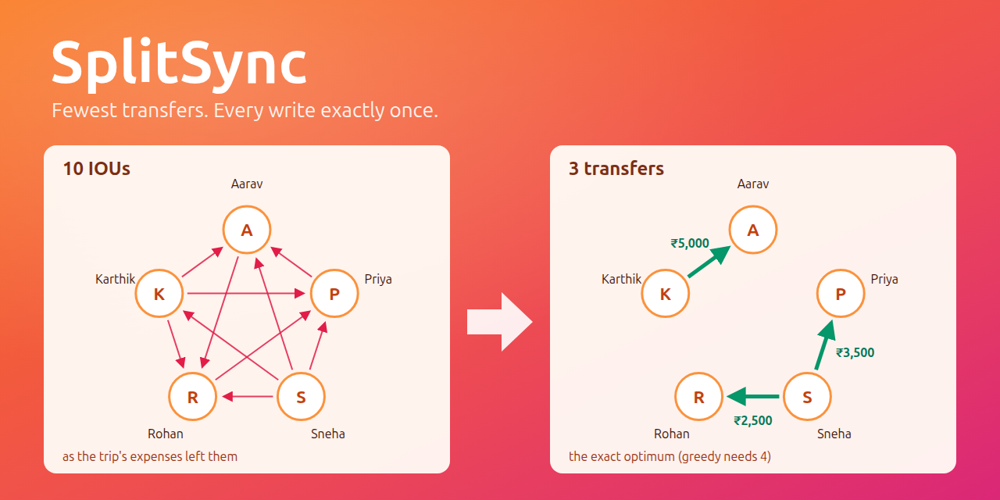

# SplitSync

[](https://github.com/Srinu-design/splitsync/actions/workflows/ci.yml)

A real-time group expense splitter. **It turns a group's tangle of IOUs into the fewest transfers, records every
write exactly once even when ten phones submit at the same moment, and keeps every change, edits and deletes
included, as history you can undo.** It records payments; it never moves money.



*The seeded "Goa Road Trip": 8 expenses among 5 friends leave 10 pairwise IOUs. The exact solver settles them in 3
transfers; the two-heap greedy needs 4.*

## Live demo

- Web page: <https://3-25-14-19.sslip.io/splitsync/>. No login: **Start a demo room** gives you a private seeded room
  with a chaos panel to race ten requests against each other.
- Health: <https://3-25-14-19.sslip.io/splitsync/readyz>

The server is one EC2 instance that runs on demand to save cost. If the link does not answer, it is switched off;
everything also runs locally with one command ([Quickstart](#quickstart)).

## Headline numbers

All measured, with details in [docs/benchmarks.md](docs/benchmarks.md):

| | |
|---|---|
| **Fewest transfers** | Demo trip: **10 IOUs → 3 transfers** (exact bitmask DP); greedy needs 4 |
| **Exactly once** | 10 devices record one payment at once: **1 × 201, 9 × 409**; the same request × 10: **1 × 201, 9 × 200** replays of one receipt, 1 row. Both on the live server |
| **Lost updates, made visible** | Naive mode, 10 devices: Σ balances stays ₹0, but the ledger check shows **±₹45,000** drift each on Aarav and Karthik |
| **A full group** | 50 members, 9,900 expense versions, 9,900 settlements: snapshot **276 ms**, history page **5 ms**, search **10 ms** median, write **48 ms** (laptop) |
| **Deploy** | Push → CI → host build, migrate, swap and **smoke test in 18 s**, with automatic rollback |

Naive mode is the control: the same ten requests without the room lock, the version check and the idempotency key.
It shows the race is real, and that a "balances sum to zero" check cannot see it.

## Architecture


PostgreSQL 16 is the single source of truth. Every write locks its room row (`SELECT … FOR UPDATE`), re-checks the
idempotency key inside that lock, checks the version the write depends on, and changes balances with atomic SQL in
the same transaction. The ledger is append-only: an edit or delete adds a reversal entry, so the history is complete
and any delete can be undone. Redis only coordinates: Pub/Sub sends each new snapshot to every Uvicorn worker's
WebSockets, counters rate-limit the public site, and a lock lets one worker run the expiry sweep. All three fail
open. How and why: [docs/design.md](docs/design.md). Fourteen UML diagrams, from use cases to the database and each
request: [docs/diagrams.md](docs/diagrams.md).


## Features, and the test that proves each

| Feature | Proof |
|---|---|
| Money is integer paise; ₹100 ÷ 3 = 33.34 / 33.33 / 33.33, the extra paisa rotates | [test_allocation.py](tests/unit/test_allocation.py): 2,000 random splits, each share within 1 paisa; [test_expenses.py](tests/integration/test_expenses.py) `test_equal_split_rotates_the_extra_paisa` |
| Greedy (≤ N−1 transfers) and the exact minimum (bitmask DP, up to 15 non-zero balances) | [test_simplify.py](tests/unit/test_simplify.py): seed greedy 4, optimal 3, random balances settle with the minimum |
| 10 devices record one payment: 1 commit, 9 stale-version rejections; same key: 9 replays | [test_settlements.py](tests/integration/test_settlements.py) `test_protected_races_replay_and_changed_key` |
| Same key with a different body is refused (422), not replayed | [test_expenses.py](tests/integration/test_expenses.py) `test_expense_key_cannot_be_reused_for_a_changed_body` |
| Ten different expenses at once all commit, zero drift | [test_expenses.py](tests/integration/test_expenses.py) `test_ten_different_expenses_all_commit` |
| Naive mode loses updates; the ledger check sees the exact drift | [test_settlements.py](tests/integration/test_settlements.py) `test_naive_race_reproduces_exact_drift`, [test_state.py](tests/integration/test_state.py) `test_snapshot_reports_exact_naive_drift` |
| Edit, delete and Undo as reversal entries; nothing is overwritten | [test_edit_delete.py](tests/integration/test_edit_delete.py) `test_ordered_edit_delete_sequence`, `test_service_sql_keeps_the_ledger_append_only` |
| Two edits of one version: 1 applied, the other gets 409 `EXPENSE_CHANGED` | [test_edit_delete.py](tests/integration/test_edit_delete.py) `test_ordered_edit_delete_sequence` (10 at once) |
| The database refuses what the code must never do | [test_schema.py](tests/integration/test_schema.py): cross-room keys, two successors, double reversal, duplicate protected key |
| Lock timeout is a retryable 409 `GROUP_BUSY`; deadlocks retry | [test_db.py](tests/unit/test_db.py), [test_rooms.py](tests/integration/test_rooms.py) `test_room_lock_timeout_is_a_retryable_busy_response` |
| History feed with keyset paging; prefix search | [test_history.py](tests/integration/test_history.py), [test_search.py](tests/integration/test_search.py), [test_query_cursors.py](tests/unit/test_query_cursors.py) |
| A write on one worker reaches sockets on the other | [test_multiworker_fanout.py](tests/e2e/test_multiworker_fanout.py) against the compose stack |
| Redis down: writes still commit, local sockets still update, rate limits fail open | [test_redis_down.py](tests/integration/test_redis_down.py), [test_rate_limit.py](tests/integration/test_rate_limit.py) `test_rate_limit_redis_down_fail_open` |
| WebSocket Origin check, per-IP caps, 1 KB message limit | [test_ws.py](tests/integration/test_ws.py) |
| Rate limits, 16 KB body limit, RFC 9457 Problem Details, request ids | [test_rate_limit.py](tests/integration/test_rate_limit.py) |
| CSP and no `innerHTML`: user text is only ever `textContent` | [test_pages.py](tests/integration/test_pages.py), [test_static_safety.py](tests/unit/test_static_safety.py) |
| Demo rooms expire; one worker sweeps at a time | [test_sweep.py](tests/integration/test_sweep.py) |
| Deploy: forced-command key, smoke test, automatic rollback | [test_deploy_script.py](tests/unit/test_deploy_script.py), [test_smoke.py](tests/integration/test_smoke.py) |

Built with Python 3.12, FastAPI, PostgreSQL 16, Redis 8, plain JavaScript (no framework, no build step), Caddy,
Docker Compose, GitHub Actions and one EC2 instance.

## Quickstart

```bash
docker compose up -d --build --wait
```

Open <http://localhost:8300>. PostgreSQL is on `localhost:5433` (database `splitsync`, user `postgres`, password
`dev`) and Redis on `localhost:6380`. Stop with `docker compose down`.

Tests:

```bash
uv run pytest tests/unit tests/integration -q   # needs the compose Postgres and Redis
uv run pytest tests/e2e -q                       # two-worker fan-out against the running stack
PYTHONPATH=. uv run python tests/load/big_room.py   # the full-group load check
```

## Docs

- [Design](docs/design.md): money, exactly-once under concurrency, edits and history, debt simplification,
  realtime, what breaks at 10x, failure modes, security, limitations
- [Diagrams](docs/diagrams.md): 14 UML diagrams: use cases, components, deployment, classes, the database,
  two state machines, seven sequences and an activity diagram
- [Benchmarks](docs/benchmarks.md): the laptop and EC2 load checks, the live chaos results, the deploy
- [Deploying](docs/deploy.md): the host, one-time setup, a release, CI's deploy key, stopping and starting
- [Demo script](docs/demo.md): the four-minute live demo, step by step
- Decision records:
  [0001 Integer paise](docs/adr/0001-integer-paise-and-largest-remainder-splits.md) ·
  [0002 Append-only ledger](docs/adr/0002-append-only-ledger-with-reversal-entries.md) ·
  [0003 Postgres owns correctness](docs/adr/0003-postgres-owns-correctness.md) ·
  [0004 Idempotency keys](docs/adr/0004-idempotency-keys.md) ·
  [0005 Edit vs settlement versions](docs/adr/0005-per-expense-version-for-edits-graph-version-for-settlements.md) ·
  [0006 Greedy plus exact DP](docs/adr/0006-greedy-plus-exact-bitmask-dp.md) ·
  [0007 The "before" graph](docs/adr/0007-before-graph-uses-expenses-only.md) ·
  [0008 Redis fails open](docs/adr/0008-redis-for-coordination-only-fails-open.md) ·
  [0009 Versioned snapshots](docs/adr/0009-websockets-send-versioned-snapshots-refetch-heals.md) ·
  [0010 History clock and search](docs/adr/0010-graph-version-as-history-clock-keyset-pages-prefix-search.md) ·
  [0011 No login, demo rooms vs groups](docs/adr/0011-no-login-demo-rooms-vs-groups-abuse-controls.md) ·
  [0012 Single-host deploy](docs/adr/0012-single-host-deploy-build-on-host-forced-command-ssh-caddy-https.md)
- [AI usage notes](docs/ai-usage.md)

## Known limitations

- **One host.** No high availability, and no automated backups yet.
- **No accounts.** Anyone with a room's link can change it; links are unguessable (64 random bits), not secret
  from people you share them with.
- **Publish after commit is not atomic.** If a worker dies between the commit and the Redis publish, that update
  reaches other screens on their next 30-second re-fetch. A transactional outbox would close the gap.
- **The exact solver stops at 15** people with a non-zero balance; above that the plan is greedy, and says so.
- **The demo server is a t3.small.** When its CPU credits run out it drops to 20% of a CPU; the EC2 numbers in
  [benchmarks](docs/benchmarks.md) were taken in that state on purpose.
