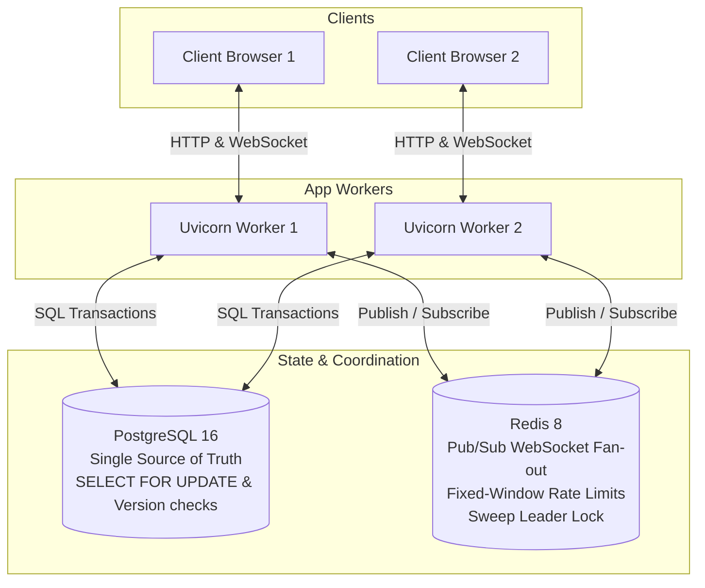

# SplitSync

> Real-time expense splitter with debt simplification, append-only edit history and exactly-once writes.

SplitSync is a real-time group expense splitter. It turns a group's tangle of IOUs into the fewest transfers, records every write exactly once even when several clients submit at the same moment, and keeps every change — edits and deletes included — as history you can undo.

Money is integer paise, so balances always sum to exactly zero, and the ledger is append-only: an edit or delete adds a reversal entry instead of overwriting, so history is complete and any delete can be undone. Postgres row locks, version checks and idempotency keys enforce exactly-once writes, and every open client receives new state over WebSockets via Redis Pub/Sub.

**Live demo: [https://3-25-14-19.sslip.io/splitsync/](https://3-25-14-19.sslip.io/splitsync/)**: no login; *Try it* gives you a private seeded room. The host may be stopped between demos to save credits. Deployment: [docs/deploy.md](docs/deploy.md).

---

## Architecture

SplitSync separates correctness from coordination: PostgreSQL 16 is the single source of truth and guarantees data integrity via row locks and atomic balance updates; Redis handles Pub/Sub message fan-out across Uvicorn workers and fixed-window rate limits.



---

## Local Setup

Start the local stack with Docker Compose:

```bash
docker compose up -d --build --wait
```

Open [http://localhost:8300](http://localhost:8300) in your browser.

- Application: `http://localhost:8300`
- PostgreSQL: `localhost:5433` (database: `splitsync`, user: `postgres`, password: `dev`)
- Redis: `localhost:6380`

To stop the containers:

```bash
docker compose down
```

---

## Testing

Run the test suites locally using `uv`:

### 1. Unit & Integration Tests

```bash
uv run pytest tests/unit tests/integration -q
```

### 2. End-to-End Tests

Verify multi-worker WebSocket fan-out against the running Docker Compose stack:

```bash
uv run pytest tests/e2e -q
```

### 3. Load Check Benchmark (SPEC §12)

Run the load check that fills a group to its caps (50 members, 9,900 expenses with ~6 splits each, 9,900 settlements, 1,000 reversals) via `COPY` and benchmarks services:

```bash
PYTHONPATH=. uv run python tests/load/big_room.py
```

---

## Load Check Benchmark Results

Measured against the local development environment (**Linux x86_64, 13th Gen Intel Core i7-13700H, PostgreSQL 16 on Docker Compose**):

| Operation | Rows | Measured Median | SPEC §12 Reference (2 vCPU) |
| --- | --- | --- | --- |
| **Snapshot build (median of 5, cache cleared before each run)** | — | **276.2 ms** | 154 ms |
| ↳ Pairwise SQL | — | 78.2 ms | — |
| ↳ Integrity queries | — | 210.9 ms | — |
| ↳ Python plans (greedy + exact) | — | 0.4 ms | — |
| **History page (50 items)** | 50 | **5.1 ms** | 9 ms |
| **Searches median (5 query types)** | 50 | **10.4 ms** | 10–42 ms |
| Search: prefix `vil` | 50 | 16.5 ms | — |
| Search: two-word `seafood din` | 50 | 24.6 ms | — |
| Search: `paid_by` filter | 50 | 4.8 ms | — |
| Search: amount range `50.00`–`70.00` | 50 | 10.4 ms | — |
| Search: `include_deleted=true` | 50 | 9.6 ms | — |
| **Writes (20 sequential via real HTTP against compose app)** | — | **48.0 ms** | 22.5 ms |
| **Database Size at maximum room caps** | — | **32 MB** | 17.6 MB |

All zero-sum ledger invariants (`zero_sum_paise == 0`, `drift == 0`, `bad_split_expenses == 0`, `orphan_edits == 0`) are validated after data generation and after the 20 writes.

### On the EC2 host

The same script on the live host (`portfolio-apps`, t3.small: 2 vCPU Xeon Platinum 8259CL, 2 GB RAM,
PostgreSQL 16 with pgvector 0.8.7), first run on a fresh database, 2026-10-29. The instance's CPU
credit balance was **0**, so it ran at the t3.small's **20% CPU baseline**: these are the host's
slowest numbers, not its burst speed.

| Operation | Median |
| --- | --- |
| Snapshot build (cache cleared; pairwise SQL 130 ms, integrity queries 310 ms) | 478 ms |
| History page (50 items) | 109 ms |
| Searches, five query shapes (each returns rows) | 14.6 ms (5.3–40.8 ms) |
| Writes (20 sequential, real HTTP, new connection each) | 89.7 ms |
| Database size with the full room | 25 MB |

Throttled numbers are noisy: a later run at the same baseline, after two more full-room fills,
measured writes at 449 ms and searches at 80 ms. Live memory (`docker stats`): splitsync-app 168 MB,
Postgres 114 MB, Caddy 49 MB, Redis 8 MB.

---

## Demo Script

Follow the step-by-step walkthrough to reproduce the sample trip, demonstrate concurrent race conditions, view the greedy vs. exact solvers, and test idempotency:

See [Live demo script (4 minutes) in docs/MASTER_GUIDE.md](docs/MASTER_GUIDE.md#live-demo-script-4-minutes).
