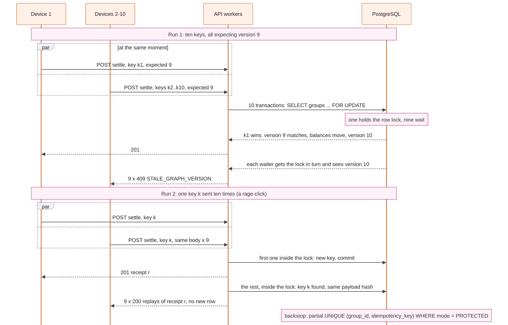
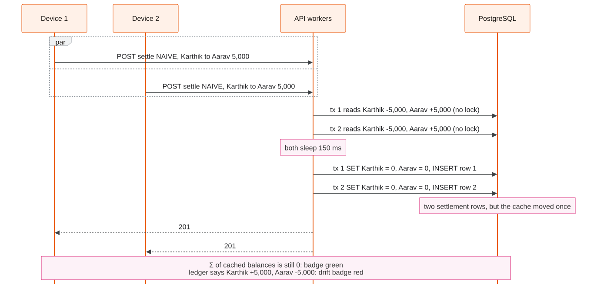
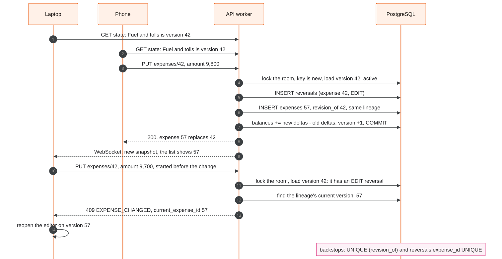

# SplitSync design

SplitSync is a real-time group expense splitter. It turns a group's tangle of IOUs into the fewest transfers,
records every write exactly once under concurrency, and preserves all history — edits and deletes included — in an
append-only ledger.

This document explains how SplitSync works and why it is built this way. Every number in it was measured; raw data
is in [benchmarks.md](benchmarks.md). Records of each architectural decision are in [adr/](adr/). The UML diagrams
are in [diagrams.md](diagrams.md).

---

## 1. Problem, goals and non-goals

### The problem

When friends share costs on a trip or in an apartment, pairwise accounting quickly degenerates into an unreadable
web of debts. Five people on an 8-expense holiday can generate 10 pairwise debts where everyone owes someone else.
A naive splitter gets four things wrong:
1. They use floating-point numbers, creating rounding drift where balances stop summing to zero.
2. They allow concurrent lost updates: two roommates submitting payments simultaneously overwrite each other's balances.
3. They overwrite database rows on edits and deletes, destroying audit trails and preventing undo.
4. They rely on greedy heuristics that fail to find the true minimum number of debt transfers.

### Goals

- **Zero-sum integer accounting.** Balances must always sum to exactly ₹0.00 across all members at all times.
- **Append-only audit trail.** Edits and deletes never mutate or delete existing rows; they record reversal entries so full history is preserved and any deletion can be undone.
- **Exactly-once writes.** Under high concurrency, double-taps, network retries, and racing edits must either replay cleanly or fail with deterministic conflict errors.
- **Optimal debt simplification.** Compute both a fast greedy plan and an exact bitmask dynamic programming plan that finds the absolute minimum number of settlement payments.
- **Real-time fan-out.** Every connected device in a room receives full state updates over WebSockets immediately after any write commits.
- **Unattended deployment.** A green CI run on `main` deploys to EC2, smoke-tests the new release and rolls back by itself if the test fails.

### Non-goals

- **Moving money.** SplitSync never moves money. Users settle debts out-of-band (e.g. via UPI, cash, or bank transfer); SplitSync only records these payments to balance the ledger.
- **Multi-region active-active database.** One PostgreSQL database is the single transactional source of truth.
- **High-availability clustering.** SplitSync runs on a single AWS EC2 instance (`t3.small`). If the virtual machine halts, SplitSync is unavailable until restarted.
- **User accounts and authentication.** Rooms are reached by unguessable random slugs (64 bits); there are no passwords, OAuth flows, or user identity directories.

---

## 2. Architecture

SplitSync separates transactional correctness from multi-worker coordination:



- **PostgreSQL 16** is the single source of truth. It owns row locks, optimistic version checks, composite foreign keys, and atomic balance increments.
- **Redis 8** handles non-durable coordination: WebSocket Pub/Sub message fan-out, fixed-window rate limiting, and a leader lock for the background room-expiry sweep.
- **Caddy 2** terminates TLS, manages Let's Encrypt certificates automatically for `3-25-14-19.sslip.io`, and proxies HTTP/2 and WebSocket connections to the FastAPI app.
- **FastAPI / Uvicorn (2 workers)** runs stateless application logic with pure domain engines for money allocation and debt simplification.

### The life of a write

```
Client (Browser)
   │  POST /api/rooms/{slug}/expenses  [Idempotency-Key: k, X-Acting-Member: 2]
   ▼
Caddy (Reverse Proxy) ── TLS termination & HTTP/2 stream multiplexing
   │
   ▼
SplitSync Worker (FastAPI)
   │  1. BodyLimitMiddleware enforces <= 16 KB body limit
   │  2. ObservabilityMiddleware assigns X-Request-ID
   │  3. require_rate_limit checks a Redis fixed-window counter (60/min)
   ▼
write_tx (app/db.py)
   │  BEGIN TRANSACTION
   │  SET LOCAL lock_timeout = '2s'; SET LOCAL statement_timeout = '5s';
   │  SELECT id, kind, graph_version FROM groups WHERE slug = :slug FOR UPDATE;
   │
   ├─► Check Idempotency: SELECT response_json FROM expenses/settlements/reversals WHERE key = :k
   │   (If key exists: compare payload_hash; replay 200 or reject 422 IDEMPOTENCY_KEY_REUSED)
   │
   ├─► Validate domain rules (room limits, participant membership via composite FK)
   │
   ├─► UPDATE groups SET graph_version = graph_version + 1 RETURNING graph_version (bump clock)
   │
   ├─► INSERT INTO expenses (id, group_id, version, ...) + INSERT INTO expense_splits (...)
   │
   ├─► UPDATE members SET net_balance_paise = net_balance_paise + :delta (ordered by member ID)
   │
   ▼  COMMIT TRANSACTION
   │
FastAPI BackgroundTasks
   │  1. Return HTTP 201 Created with JSON receipt
   ▼
publish_snapshot_task (app/services/realtime.py)
   │  Builds versioned snapshot from PostgreSQL
   │  PUBLISH splitsync:room:{group_id} payload ──► Redis 8 Pub/Sub
                                                         │
   ┌─────────────────────────────────────────────────────┘
   ▼
All Uvicorn Workers (redis_listener)
   │  Receive Pub/Sub broadcast
   ▼
ConnectionManager.broadcast()
   │  Iterates local room WebSocket connections
   ▼
Connected Clients (WebSockets)
   Client renders a snapshot only if its version is newer than the one shown
   DOM updates reactively via safe textContent mutations
```



---

## 3. Money

### Integer paise representation

Money in SplitSync is stored exclusively as 64-bit integers (`BIGINT`) of Indian paise (₹1 = 100 paise). The maximum allowable expense or payment is capped at ₹10,00,000.00 (`MAX_PAISE = 100_000_000` paise in [`app/domain/money.py`](../app/domain/money.py)).

Floating-point numbers (`float`) are strictly forbidden from domain calculations and database schemas. Floating-point arithmetic fails on standard decimal fractions: in IEEE 754 floating point, `0.1 + 0.2 != 0.3`, and `₹100 / 3` evaluates to `33.333333333333336`, causing fractional paise drift.

User inputs arrive as formatted decimal strings (e.g., `"100.50"`). Parsing occurs through Python's `Decimal` module in [`parse_rupees()`](../app/domain/money.py):
```python
paise = int((Decimal(s) * 100).to_integral_exact())
```
The resulting integer maps directly to SQL `BIGINT`. Summing balances across all members is an exact integer operation: `SELECT sum(net_balance_paise) FROM members WHERE group_id = :gid` must evaluate to exactly `0`.

### Largest remainder method (Hamilton-Hare)

Splitting ₹100.00 among three people yields `10,000` paise divided by `3`. A naive integer division gives `3,333` paise each, losing `1` paisa (`₹99.99` total).

SplitSync implements the Hamilton largest remainder method in [`app/domain/allocation.py`](../app/domain/allocation.py):
1. **Base integer share:** Each participant receives the floor of their proportional share:
   $$\text{base}_m = \left\lfloor \frac{\text{total} \times w_m}{\sum w} \right\rfloor$$
2. **Remainder calculation:** The fractional remainder for each participant is:
   $$\text{rem}_m = (\text{total} \times w_m) \pmod{\sum w}$$
3. **Leftover distribution:** The total unallocated paise $\Delta = \text{total} - \sum \text{base}_m$ are distributed 1 paisa at a time to participants with the largest fractional remainders $\text{rem}_m$.

### Rotation tie-breaking

When multiple members have identical remainders, giving the extra paisa to the first member in lexicographic order would systematically penalize them over time.

SplitSync resolves ties by rotating the priority list using the unique `expense_id` as a pseudo-random rotation offset:
```python
rot = rotation % len(ids)
order = ids[rot:] + ids[:rot]
pos = {m: i for i, m in enumerate(order)}
winners = set(sorted(ids, key=lambda m: (-rem[m], pos[m]))[:leftover])
```
Every share lands within 1 paisa of its mathematical ideal. This invariant is checked by a Hypothesis property test over 2,000 random splits in [`tests/unit/test_allocation.py`](../tests/unit/test_allocation.py).

---

## 4. Exactly-once under concurrency

### What really races

In a multi-user collaborative financial application, three distinct race conditions occur:
1. **Rage clicks & network retries:** A user on a spotty mobile connection clicks "Record Payment" multiple times, or a mobile client times out and retries while the server is still processing the initial request.
2. **Double recording:** Two roommates attend dinner; both open UPI, transfer ₹500, and tap "Record Payment" on their respective phones at the exact same second.
3. **Concurrent balance updates:** Two different writers concurrently read a member's current balance and attempt to write back an updated value.

Crucially, **two people adding two completely different expenses at the same time is not a conflict**. Both writes must succeed without blocking or failing, while maintaining strict zero-sum ledger invariants.



### Pessimistic room lock vs optimistic version check

SplitSync uses a two-tier concurrency control strategy:

| Mechanism | Scope | Purpose | Failure Mode / HTTP Response |
|---|---|---|---|
| **Pessimistic Lock** (`groups ... FOR UPDATE`) | In-flight execution window | Serializes overlapping database transactions on the same room | `409 GROUP_BUSY` (if lock wait > 2s) |
| **Optimistic Version Check** (`expected_graph_version`) | Out-of-band human thinking time | Detects stale writes submitted from an outdated UI screen | `409 STALE_GRAPH_VERSION` |

A row lock alone cannot prevent double payment recording: if roommate A submits a settlement at 12:00:00 and roommate B submits the same settlement at 12:00:02, the row lock for A will release before B begins. B's transaction would acquire the lock and succeed, double-counting the settlement.

SplitSync enforces that `POST /settlements` must provide `expected_graph_version`. When roommate A commits, `groups.graph_version` increments from $v$ to $v+1$. When roommate B's request executes, B's expected version ($v$) mismatches the database version ($v+1$), and the transaction aborts with `409 STALE_GRAPH_VERSION`.

### Idempotency re-checked inside the lock

Checking idempotency before acquiring the room lock is vulnerable to a classic check-then-act race: two identical requests arrive in parallel, both find no prior key, both proceed to wait on the lock, and the second request causes a duplicate insert or constraint violation.

SplitSync performs idempotency lookup **inside the pessimistic row lock**:
```python
async def protected(connection):
    room = await lock_room(connection, slug)  # SELECT ... FOR UPDATE
    replay = await lookup_idempotency(connection, room["id"], key, request_hash)
    if replay is not None:
        return replay
```
If ten identical requests arrive concurrently:
1. Request 1 acquires the lock, validates, inserts the expense, records the key and hash, bumps `graph_version`, commits, and returns `201 Created`.
2. Requests 2 through 10 wait on the lock. When request 2 acquires the lock, [`lookup_idempotency()`](../app/services/shared.py) finds request 1's committed receipt, verifies that the SHA-256 payload hash matches, and returns `200 OK` with header `Idempotent-Replayed: true`.
3. If an idempotency key is reused with a mutated payload (different amount, payer, or split), [`lookup_idempotency()`](../app/services/shared.py) aborts with `422 IDEMPOTENCY_KEY_REUSED`.

The database backstop is a partial unique index on the tables:
```sql
CREATE UNIQUE INDEX settlements_idem_protected ON settlements (group_id, idempotency_key) WHERE mode = 'PROTECTED';
```

### Lock order and deadlock retry in `app/db.py`

When multiple transactions update several rows, acquiring row locks in divergent order causes deadlocks. SplitSync prevents deadlocks through strict global lock ordering:
1. **Room level:** Acquire exclusive row lock on `groups` row (`WHERE slug = :slug FOR UPDATE`).
2. **Member level:** Acquire member locks and apply balance deltas ordered strictly by ascending member primary key (`ORDER BY id`):
   ```python
   for member, delta in sorted(deltas.items()):
       await connection.execute(
           text(
               "UPDATE members SET net_balance_paise = net_balance_paise + :delta WHERE group_id = :gid AND id = :member"
           ),
           {"gid": gid, "member": member, "delta": delta},
       )
   ```

In [`app/db.py write_tx()`](../app/db.py), transactions configure explicit timeouts:
- `SET LOCAL lock_timeout = '2s'`
- `SET LOCAL statement_timeout = '5s'`

If a transaction waits more than 2 seconds for a lock, PostgreSQL raises SQLSTATE `55P03` (`lock_not_available`), which `write_tx()` catches and converts into HTTP `409 Conflict` with error code `GROUP_BUSY` and header `Retry-After: 1`.

If unexpected serialization failures (`40001`) or deadlock conditions (`40P01`) occur, `write_tx()` tries the transaction up to 3 times in all, sleeping a random 50–200 ms between tries:
```python
except DBAPIError as error:
    state = getattr(error.orig, "sqlstate", None)
    if state == "55P03":
        raise ApiError(409, "GROUP_BUSY", "Room is busy", "Try the write again shortly.", headers={"Retry-After": "1"})
    if state not in {"40001", "40P01"} or attempt == 2:
        raise
    await asyncio.sleep(random.uniform(0.05, 0.2))
```

### Naive mode demonstration

SplitSync includes an intentional demo mode (`mode = "NAIVE"`) enabled only in demo rooms (`settings.ENABLE_NAIVE_MODE = True`). Naive mode demonstrates the catastrophic failure mode of traditional CRUD architectures:
1. It does not lock the room (`SELECT ... FROM groups` without `FOR UPDATE`).
2. It bypasses idempotency lookups and version checks.
3. It performs a non-atomic read-modify-write on member balances:
   ```python
   balances = await member_balances(connection, room, body, acted_by, locked=False)
   await asyncio.sleep(settings.NAIVE_RACE_DELAY_MS / 1000)
   for member, delta in sorted(deltas.items()):
       await connection.execute(
           text("UPDATE members SET net_balance_paise = :balance WHERE group_id=:gid AND id=:member"),
           {"gid": room["id"], "member": member, "balance": balances[member] + delta},
       )
   ```

When 10 concurrent payments of ₹5,000 are recorded in naive mode:
- All 10 requests read the initial balances.
- All 10 compute the exact same absolute balance and overwrite the row.
- **The naive zero-sum check ($\sum \text{balances} = 0$) stays green** because the payer and payee balances were shifted by identical amounts.
- **The ledger integrity check turns red:** recomputing true balances from the append-only ledger reveals that Aarav and Karthik have drifted by $\pm ₹45,000$ from their true financial positions.



---

## 5. Edits, history and search

### Reversal entries and `revision_of`

SplitSync follows the accounting rule that a ledger is never rewritten: no write path runs `UPDATE` or `DELETE` on a recorded expense or settlement. The only deletions are whole-room ones: resetting a demo room, and the sweep removing rooms that expired.



- **Editing an expense:**
  1. An edit transaction inserts a row into `reversals` targeting the previous `expense_id` with reason `'EDIT'`.
  2. A new version row is inserted into `expenses` with `revision_of = :old_expense_id` and `lineage_id = :target_lineage_id`.
  3. Cached member balances are updated by applying the compound delta:
     $$\Delta = \text{negate}(\text{old\_splits}) + \text{new\_splits}$$
  4. Database constraints enforce that each expense version can have at most one revision (`revision_of BIGINT UNIQUE`).

- **Deleting an expense:**
  1. A reversal row is inserted into `reversals` with `reason = 'DELETE'`, referencing the expense.
  2. Member balances are credited/debited with $\text{negate}(\text{stored\_splits})$.
  3. The expense disappears from `active_expenses` view:
     ```sql
     CREATE VIEW active_expenses AS
       SELECT e.* FROM expenses e
       WHERE NOT EXISTS (SELECT 1 FROM reversals r WHERE r.expense_id = e.id);
     ```

- **Restoring an expense (Undo):**
  1. A restore transaction verifies that the target was deleted and has no existing successor.
  2. It inserts a fresh expense row copying the original expense attributes, referencing `revision_of = :deleted_expense_id`.
  3. Member balances are reapplied with positive stored splits.

### Per-expense optimistic locking

Settlements depend on every balance in the room, so settlements check the room-wide `graph_version`. However, forcing expense edits to check the room-wide `graph_version` would cause false conflicts: editing the dinner bill would fail if someone added an unrelated taxi fare.

Edits check **per-expense versioning**:
- The client submits `PUT /api/rooms/{slug}/expenses/{expense_id}` specifying the specific version currently on their screen.
- If another user edits that same expense first, the original version is reversed. When the second editor's write executes, [`load_expense()`](../app/services/expenses.py) detects `target["reversal_reason"] is not None`.
- The server rejects the write with `409 Conflict`, error code `EXPENSE_CHANGED`, and provides `current_expense_id` so the client UI can automatically reload and display the newest revision:
  ```python
  if target["reversal_reason"] is not None:
      await expense_changed(connection, room, target)
  ```
Tested under concurrency: 10 simultaneous edits to the same expense version produce 1 successful commit and 9 deterministic `409 EXPENSE_CHANGED` rejections ([`tests/integration/test_edit_delete.py`](../tests/integration/test_edit_delete.py)).

### `graph_version` as the history clock

Every state-modifying write (expense creation, edit, deletion, restore, settlement, settlement reversal, member addition) monotonically increments `groups.graph_version` by 1.

Every ledger row stamps the `version` that introduced it. This allows `graph_version` to serve as a logical timeline clock across four distinct database tables: `expenses` (rank 3), `settlements` (rank 2), `reversals` (rank 1), and `members` (rank 0).

### Keyset pagination

Traditional `OFFSET / LIMIT` pagination suffers from $O(N)$ query degradation as offsets increase, and produces phantom/skipped rows when new writes arrive while a user is paging.

SplitSync uses deterministic keyset pagination in [`app/services/history.py`](../app/services/history.py):
- The cursor is an opaque base64-encoded tuple: `version.rank.id`.
- The SQL query applies individual `LIMIT :lim` filters to each table partition before taking the union:
  ```sql
  SELECT version, rank, id, kind, data FROM (
    (SELECT e.version, 3 AS rank, e.id, 'EXPENSE' AS kind, ... FROM expenses e
     WHERE e.group_id = :gid AND (e.version, 3, e.id) < (:cv, :ck, :cid)
     ORDER BY e.version DESC, e.id DESC LIMIT :lim)
    UNION ALL
    (SELECT s.version, 2, s.id, 'SETTLEMENT', ... FROM settlements s
     WHERE s.group_id = :gid AND (s.version, 2, s.id) < (:cv, :ck, :cid)
     ORDER BY s.version DESC, s.id DESC LIMIT :lim)
    UNION ALL
    (SELECT r.version, 1, r.id, 'REVERSAL', ... FROM reversals r
     WHERE r.group_id = :gid AND r.reason = 'DELETE' AND (r.version, 1, r.id) < (:cv, :ck, :cid)
     ORDER BY r.version DESC, r.id DESC LIMIT :lim)
    UNION ALL
    (SELECT m.version, 0, m.id, 'MEMBER', ... FROM members m
     WHERE m.group_id = :gid AND (m.version, 0, m.id) < (:cv, :ck, :cid)
     ORDER BY m.version DESC, m.id DESC LIMIT :lim)
  ) a
  ORDER BY version DESC, rank DESC, id DESC LIMIT :lim;
  ```
PostgreSQL executes index range scans using `expenses_group_version`, reading at most $4 \times (\text{limit} + 1)$ rows total. Measured response time for a 50-item page on a full 10,000-row room is **5.1 ms local** and **9 ms SPEC reference**.

### Scoped prefix full-text search without GIN

Search queries in [`app/services/search.py`](../app/services/search.py) allow filtering expenses by title keywords, payer, participant, rupee amount ranges, and date boundaries.

SplitSync utilizes PostgreSQL's native full-text engine configured with the `'simple'` dictionary (case-insensitive tokenization without English stemming):
- The `expenses` table contains a stored generated column:
  ```sql
  title_tsv tsvector GENERATED ALWAYS AS (to_tsvector('simple', title)) STORED
  ```
- Search tokens are converted into prefix queries joined with `&`: `"seafood din"` becomes `'seafood':* & 'din':*`.
- **Why no GIN index?** A GIN index on `title_tsv` across all rooms would search the entire multi-tenant table before filtering by `group_id`. Because room sizes are bounded at 10,000 expenses, the B-tree index on `(group_id, spent_on DESC, id DESC)` narrows the scan to the room first. The in-memory text scan runs in **10.4 ms local** (10–42 ms reference), eliminating the write overhead and storage bloat of GIN index maintenance.

---

## 6. Debt simplification



### Pairwise graph ("Before")

The pairwise graph represents direct debts as incurred: if Rohan paid ₹6,100 for dinner and Aarav was a split member, Aarav owes Rohan directly.
Debts between pairs are netted: if Aarav owes Rohan ₹1,000 and Rohan owes Aarav ₹400, the net edge is Aarav $\rightarrow$ Rohan ₹600.

**The "before" graph aggregates active expenses only; it never includes settlements.**
If settlements were subtracted from pairwise edges, settling via the optimal plan would create phantom cancelling debt loops (e.g., A owes B, B owes C, C owes A) that do not cancel pairwise. The left graph illustrates what debts were incurred; the right graph illustrates what remains to be paid from net balances.

### Two-heap greedy algorithm

The greedy debt simplification algorithm runs in $O(N \log N)$ time:
1. Members with positive balances are pushed to a max-heap of creditors; members with negative balances are pushed to a max-heap of debtors.
2. In each iteration, pop the largest creditor $C$ and largest debtor $D$.
3. Transfer $\text{amt} = \min(C, D)$ from $D$ to $C$.
4. Push any remaining balance back onto the respective heap.

Greedy guarantees at most $N - 1$ transfers because each transfer completely zeros out at least one person's balance. However, **greedy is not always optimal**.

On the seeded "Goa Road Trip" demo room:
- Net balances: Aarav +₹5,000, Priya +₹3,500, Rohan +₹2,500, Sneha −₹6,000, Karthik −₹5,000.
- Greedy produces **4 transfers**:
  1. Sneha $\rightarrow$ Aarav: ₹5,000
  2. Karthik $\rightarrow$ Priya: ₹3,500
  3. Karthik $\rightarrow$ Rohan: ₹1,500
  4. Sneha $\rightarrow$ Rohan: ₹1,000

### Exact bitmask dynamic programming (LeetCode 465)

The minimum number of transfers required to settle an account network is:
$$\text{Min Transfers} = n - S_{\max}$$
where $n$ is the number of participants with non-zero balances, and $S_{\max}$ is the maximum number of disjoint zero-sum subsets that partition the balances. Deciding whether even one zero-sum subset exists is equivalent to the NP-complete Subset Sum problem.

SplitSync implements an exact $O(2^n \cdot n)$ bitmask dynamic programming algorithm in [`app/domain/simplify.py`](../app/domain/simplify.py):
1. Let $dp[\text{mask}]$ store the maximum number of zero-sum groups that can be formed from the subset of members represented by the bitmask.
2. Precompute $s[\text{mask}] = \sum_{i \in \text{mask}} \text{balance}[i]$.
3. For every mask from 1 to $2^n - 1$:
   $$dp[\text{mask}] = \max_{i \in \text{mask}} (dp[\text{mask} \setminus \{i\}]) + (1 \text{ if } s[\text{mask}] == 0 \text{ else } 0)$$
4. Trace back the bitmask transitions to identify the partition subsets.
5. Apply the greedy solver inside each zero-sum subset independently. Because a zero-sum subset has no zero-sum sub-partitions, greedy inside the subset is mathematically guaranteed to be minimal ($k - 1$ transfers for $k$ members).

On the Goa demo room, the exact solver identifies two zero-sum subsets:
- Group 1: {Karthik −₹5,000, Aarav +₹5,000} $\rightarrow$ sum = 0 (1 transfer)
- Group 2: {Sneha −₹6,000, Priya +₹3,500, Rohan +₹2,500} $\rightarrow$ sum = 0 (2 transfers)
Total transfers: **3 optimal transfers** (a 70% reduction from the 10 pairwise debts, beating greedy's 4 transfers).

### The 15-member cut-off

Because $O(2^n \cdot n)$ exhibits exponential growth, CPU execution time scales rapidly with non-zero participants:

These are the spec's measurements of the exact solver (CPython, 2 vCPU dev container):

| Non-zero balances ($n$) | Bitmask States ($2^n$) | Execution Time | Status |
|---|---|---|---|
| 12 | 4,096 | 3.7 ms | Optimal |
| 13 | 8,192 | 12.8 ms | Optimal |
| 14 | 16,384 | 22.2 ms | Optimal |
| **15** | **32,768** | **35.6 ms** | **Optimal (Threshold)** |
| 16 | 65,536 | 75.4 ms | Fallback to Greedy |

When $n \le 15$, SplitSync displays the exact optimal plan. When $n > 15$, [`plans()`](../app/domain/simplify.py) returns `recommended = "GREEDY"`, and the UI explicitly labels the plan as greedy.

---

## 7. Realtime

### Publish after commit

```
Worker Transaction                      Redis Pub/Sub               Worker Sockets
       │                                     │                            │
   COMMIT TX ────────────────────────────────┼────────────────────────────┤
       │                                     │                            │
       ▼ (Tx successful)                     │                            │
FastAPI BackgroundTask                       │                            │
publish_snapshot_task()                      │                            │
       │                                     │                            │
       ├─► Build snapshot from Postgres      │                            │
       │                                     │                            │
       └─► redis.publish(room_channel, json) ─► Fan-out to all workers ───┼─► ws.send_text()
```

Publishing to Redis inside the database transaction is an anti-pattern: if the transaction later rolls back due to a constraint or serialization error, clients would receive phantom state.

SplitSync triggers WebSocket notification exclusively **after transaction commit** via FastAPI `BackgroundTasks` ([`app/api/__init__.py schedule_publish()`](../app/api/__init__.py)). Unchanged edits (no-ops) and idempotent replays skip background publishing to eliminate redundant network fan-out.

### Versioned snapshots

SplitSync does not publish incremental diffs (e.g., "expense 5 added"). Diffs are fragile: if a client drops a single frame or reconnects, its local state diverges.

Instead, SplitSync transmits **complete versioned snapshots**:
```json
{
  "type": "snapshot",
  "version": 42,
  "state": { "room": {...}, "members": [...], "graph": {...}, "invariants": {...} }
}
```
The page keeps the version it shows (`currentVersion` in `static/app.js`). Any incoming snapshot with `version <= currentVersion` is discarded. If packets arrive out of order, the newer version is retained and the older version is safely ignored.

### 30-second refetch healing

If a Redis node restarts or a worker dies between transaction commit and background task execution, the WebSocket message is dropped.
To guarantee eventual consistency, client browsers execute a background polling fetch `GET /api/rooms/{slug}/state` every 30 seconds and immediately upon WebSocket reconnection. A dropped broadcast costs at most 30 seconds of freshness, never data correctness.

### WebSocket caps and close codes

WebSocket lifecycle management is enforced in [`app/api/ws.py`](../app/api/ws.py) and [`app/services/realtime.py`](../app/services/realtime.py):

| Phase | Check / Condition | Action / Close Code | Reason |
|---|---|---|---|
| **Pre-Accept** | `Origin` header not in `ALLOWED_ORIGINS` | `close(code=1008)` | Policy Violation (Cross-Site WebSocket Hijacking defense) |
| **Pre-Accept** | Room does not exist or has expired | `accept()` then `close(code=4404)` | Custom application code: Room Not Found |
| **Post-Accept** | Rate limit exceeded for `ws_connect` (30/min per IP) | `close(code=1013)` | Try Again Later |
| **Post-Accept** | > 20 connections per room on worker | `close(code=1013)` | Try Again Later (per-room worker ceiling) |
| **Post-Accept** | > 5 connections per client IP on worker | `close(code=1013)` | Try Again Later (per-IP worker ceiling) |
| **Runtime** | Inbound message payload > 1,024 bytes (1 KB) | `close(code=1009)` | Message Too Big |
| **Runtime** | Slow client: socket send timeout > 2.0s | Close socket & discard | Prevents slow clients from blocking worker event loop |



---

## 8. What breaks first at 10x

A prediction, not a measurement: at roughly 100 busy rooms, 500 open WebSockets and 50 writes/s:

1. **The First Bottleneck: Snapshot Generation CPU.**
   Currently, every write triggers a full snapshot build (`OWED_SQL`, `INTEGRITY_SQL`, and Python plans). On a full group (50 members, 10,000 expenses), building a snapshot requires 276 ms local and 478 ms on EC2. At 50 writes/sec across multiple rooms, the 2 Uvicorn worker CPUs will saturate completely.
   *Fix:* build at most one snapshot per room per burst (coalesce writes that arrive while a build runs), then keep per-pair totals in Postgres updated by each write instead of rescanning every active expense.

2. **The Second Bottleneck: PostgreSQL Connection Pool.**
   The production pool is sized at `pool_size = 3`, `max_overflow = 2` per worker (`deploy/compose.prod.yaml`), allowing 10 concurrent connections to PostgreSQL (`max_connections = 60`). With 10x concurrent writes, `write_tx()` transactions queuing on `SET LOCAL lock_timeout = '2s'` will exhaust the pool.
   *Fix:* Introduce PgBouncer in transaction-pooling mode.

3. **The Third Bottleneck: Single-Host Memory.**
   The EC2 `t3.small` instance provides 2 GB RAM + 2 GB swap. Memory consumption is:
   - `splitsync-app`: 168 MB
   - `postgres`: 114 MB
   - `caddy`: 49 MB
   - `redis`: 8 MB
   The app container is capped at 400 MB; more rooms means more cached snapshots and more socket buffers, and past that cap the host starts using swap.

---

## 9. Failure modes

| Failure | Immediate Impact | How SplitSync Handles It | User Experience |
|---|---|---|---|
| **PostgreSQL down** | All writes and snapshot reads fail | `/readyz` returns 503; requests fail with an error response | The page shows an error; nothing committed is lost |
| **Redis down** | Cross-worker live updates fail; rate limiting fails | Application fails open: [`publish()`](../app/services/realtime.py) falls back to local in-process broadcast; [`check_rate_limit()`](../app/api/rate_limit.py) returns `allowed=True` | Sockets on the same worker update live; sockets on other workers update within 30s via refetch |
| **Worker process crashes** | Worker drops in-flight requests and its WebSockets | Uvicorn starts a new worker; Postgres rolls back the dead connection's transaction and releases its locks; Docker restarts the container if it exits | Browsers reconnect with backoff; a retried write with the same Idempotency-Key is replayed, not repeated |
| **Background publish lost** | Real-time WebSocket snapshot not emitted | Handled gracefully: `publish_snapshot_task()` catches error and logs warning; write remains committed | Clients heal state on the next 30-second refetch interval or on manual page reload |
| **Deployment fails smoke test** | New release fails health check or computes seed incorrectly | [`deploy/deploy.sh`](../deploy/deploy.sh) sees the failed health check or `app.smoke`, starts the previous image again and smoke-tests it | A short outage while the containers swap (seconds); then the previous release serves again |
| **Disk space fills up** | Postgres stops accepting writes | Room creation in [`app/services/rooms.py`](../app/services/rooms.py) checks `pg_database_size(current_database())` and refuses new rooms above `MAX_DB_SIZE_MB` (2,048 MB on the host) | New rooms get `503 STORAGE_FULL`; existing rooms keep working within their caps |

---

## 10. Security

1. **Content Security Policy (CSP):**
   Middleware in [`app/main.py`](../app/main.py) injects a strict Content Security Policy into every HTTP response:
   ```
   default-src 'self'; connect-src 'self'; img-src 'self' data:; style-src 'self'; script-src 'self'; base-uri 'none'; frame-ancestors 'none'
   ```
   No external CDNs, Google Analytics, or third-party origins are permitted.
2. **XSS Defense via `textContent` Only:**
   The frontend code in [`static/app.js`](../static/app.js) and [`static/graph.js`](../static/graph.js) strictly prohibits `innerHTML`, `outerHTML`, `insertAdjacentHTML`, `document.write`, or `eval()`. All dynamic values (member names, expense titles, amounts) are rendered exclusively via `element.textContent` or `document.createTextNode()`. Checked by pattern scanning in [`tests/unit/test_static_safety.py`](../tests/unit/test_static_safety.py).
3. **Cross-Site WebSocket Hijacking Protection:**
   The WebSocket route in [`app/api/ws.py`](../app/api/ws.py) inspects the `Origin` header against `settings.ALLOWED_ORIGINS` before accepting the connection. Unauthorized cross-site requests are immediately terminated with WebSocket close code `1008 Policy Violation`.
4. **Rate Limiting:**
   Enforced via Redis fixed-window counters in [`app/api/rate_limit.py`](../app/api/rate_limit.py):
   - Room creation: 10 per hour per IP
   - State writes: 60 per minute per IP
   - Naive demo writes: 30 per minute per IP
   - Reads: 120 per minute per IP
   - WebSocket handshakes: 30 per minute per IP
   Over-limit requests receive HTTP `429 Too Many Requests` with a valid `Retry-After` header.
5. **Request Body Size Limit:**
   `BodyLimitMiddleware` in [`app/middleware.py`](../app/middleware.py) inspects `Content-Length` and buffers request streams up to a hard ceiling of 16 KB (16,384 bytes). Payloads exceeding 16 KB are rejected with HTTP `413 Payload Too Large` before parsing.
6. **Unguessable Room Slugs:**
   Room identifiers are generated via `secrets.token_urlsafe(8)`: 8 random bytes (64 bits) as 11 URL-safe characters, which makes enumerating rooms impractical.
7. **SSH Forced-Command Deployment:**
   The GitHub Actions deployment key is constrained on the EC2 host's `~/.ssh/authorized_keys`:
   ```
   restrict,command="/opt/splitsync/src/deploy/deploy.sh --from-ssh" ssh-ed25519 ...
   ```
   The forced command verifies that incoming arguments match an exact 40-character hex commit SHA, `--rollback`, or `--status`. Interactive shell execution, arbitrary commands, and file transfers are rejected.
8. **Secrets Isolation:**
   Database credentials exist only on the EC2 host, in `/opt/splitsync/.env` and `/opt/portfolio/.env` (mode `0600`), generated there and never displayed. The deploy key's private half is a GitHub Actions secret; the host holds only its public half. No secret is in Git.

---

## 11. Limitations and future work

- **Single Host SPOF:** SplitSync runs on one EC2 virtual machine. An AWS hardware fault halts the service. Future work: Migrate to a managed PostgreSQL cluster (AWS RDS Multi-AZ) with container workers hosted across an ECS Fargate cluster.
- **No backups yet:** the database lives on one encrypted EBS volume with no snapshots or dumps. Automated daily `pg_dump` backups to an encrypted S3 bucket should be added.
- **No User Accounts:** Access control is link-based (bearer token slug). Anyone with the room URL has full permission to add, edit, or delete expenses. Future work: Optional passcodes or member-specific authentication keys for non-ephemeral groups.
- **Transactional Outbox for Eventual Consistency:** Background snapshot publishing currently runs in a FastAPI background task after commit. If the process is killed in the short window after the commit and before the Redis publish, the WebSocket notification is lost until the next client 30s refetch. A transactional outbox table in PostgreSQL processed via Debezium CDC or `LISTEN / NOTIFY` would provide guaranteed delivery.
