# SplitSync in diagrams

Fourteen UML diagrams, from who uses SplitSync down to single requests. Each is Mermaid text, so GitHub draws it
here, and `docs/render_diagrams.py` draws the same text to the SVG files in [images/diagrams/](images/diagrams/).
The words behind each diagram are in [design.md](design.md) and the [ADRs](adr/).

| # | Diagram | Kind | Shows |
|---|---|---|---|
| 1 | [Use cases](#1-use-cases) | Use case | Who uses SplitSync, and for what |
| 2 | [Components](#2-components) | Component | The browser, the app's parts, and what talks to what |
| 3 | [Deployment](#3-deployment) | Deployment | Where each part runs, from GitHub to the EC2 host |
| 4 | [Classes](#4-classes) | Class | The core code: pure domain functions, the write helpers, realtime |
| 5 | [Database](#5-database) | Entity–relationship | Every table, key and relationship of the append-only ledger |
| 6 | [An expense's life](#6-an-expenses-life) | State machine | Every state an expense version can be in, and every move between them |
| 7 | [A browser's connection](#7-a-browsers-connection) | State machine | Live, reconnecting with backoff, and how a lost message heals |
| 8 | [Record a payment](#8-record-a-payment) | Sequence | One protected `POST …/settlements`: lock, idempotency, version, balances |
| 9 | [Ten devices, one payment](#9-ten-devices-one-payment) | Sequence | The chaos demo: 1 × 201 and 9 × 409, then a rage-click: 1 × 201 and 9 × 200 |
| 10 | [Two people edit one expense](#10-two-people-edit-one-expense) | Sequence | A reversal plus a new version; the second editor gets 409 `EXPENSE_CHANGED` |
| 11 | [Naive mode loses an update](#11-naive-mode-loses-an-update) | Sequence | Why Σ = 0 stays green while the ledger check turns red |
| 12 | [A write reaches every screen](#12-a-write-reaches-every-screen) | Sequence | Commit, then Redis Pub/Sub to both workers, and what happens without Redis |
| 13 | [From balances to a plan](#13-from-balances-to-a-plan) | Activity | Pairwise IOUs, greedy, and the exact solver up to 15 people |
| 14 | [Deploy and roll back](#14-deploy-and-roll-back) | Sequence | From a push to a smoke-tested release, or back to the old one |

## 1. Use cases

There is no login. A visitor starts a seeded demo room or an empty group, and anyone with the room's link is a
member's device. Demo rooms add the chaos panel and reset; groups never offer them. The operator deploys and
watches.

<!-- diagram: use-cases -->
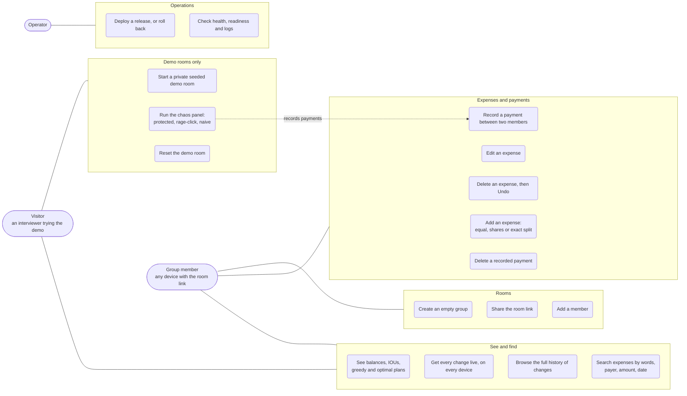

## 2. Components

One FastAPI app runs as two Uvicorn workers. Caddy is the only public entry. PostgreSQL is the single source of
truth; Redis carries only coordination (Pub/Sub, rate-limit counters, the sweep's lock), and everything it does
fails open.

<!-- diagram: components -->
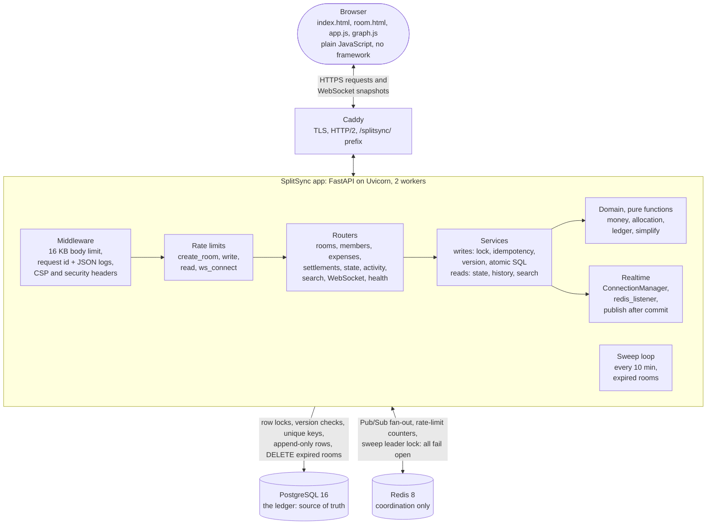

## 3. Deployment

A push to `main` runs CI; when it is green, GitHub asks the EC2 host to deploy that commit over SSH with a key
that can only run `deploy.sh`. The host builds the image from the commit, migrates, swaps and smoke-tests. Only
Caddy has public ports.

<!-- diagram: deployment -->
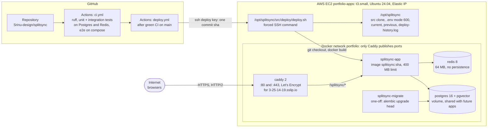

## 4. Classes

The money and graph logic is pure functions with no I/O, so it is tested without a database. Every write in the
services goes through the same few helpers inside one `write_tx`.

<!-- diagram: classes -->
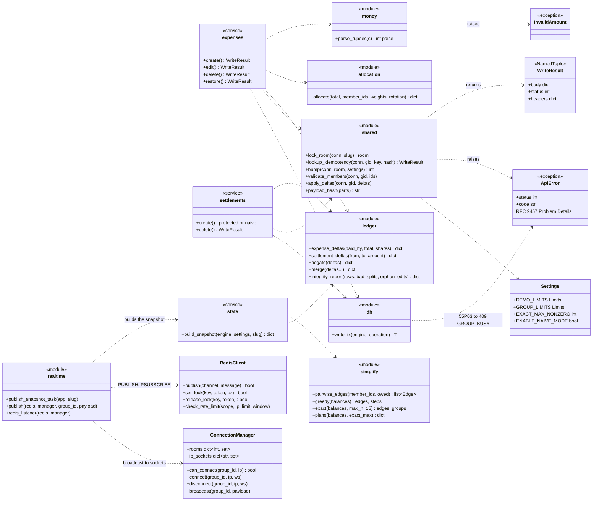

## 5. Database

Six tables and two views. Rows in `expenses`, `expense_splits`, `settlements` and `reversals` are never updated or
deleted while the room lives; `members.net_balance_paise` is a cache the integrity queries recompute. Every
foreign key inside a room includes `group_id`, so a member of another room cannot be referenced even by a bug.

<!-- diagram: database -->
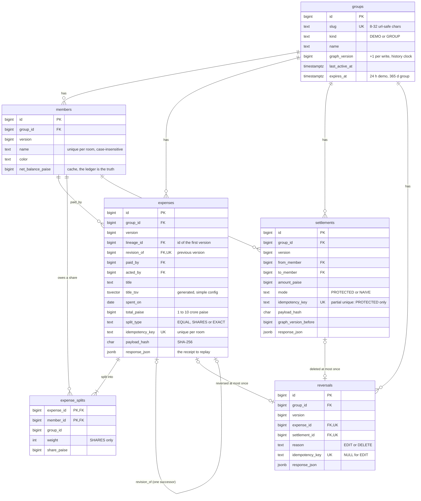

Views: `active_expenses` and `active_settlements` are the rows with no reversal. Every balance, graph and list query
reads them, never the raw tables.

## 6. An expense's life

An expense is a chain of versions sharing one `lineage_id`. Nothing is overwritten: an edit reverses the old
version and inserts a new one, a delete reverses it, and Undo inserts a copy.

<!-- diagram: expense-states -->
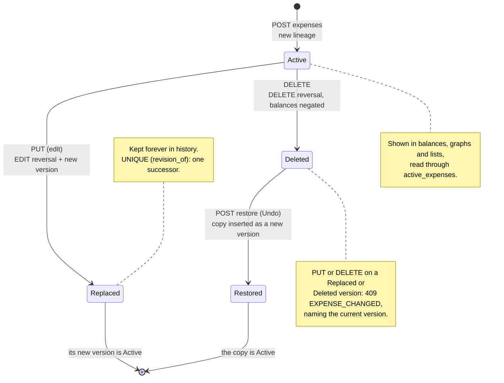

## 7. A browser's connection

Every message is a full snapshot with its `graph_version`, and the page ignores anything not newer. A lost or late
message costs freshness, never correctness: the page re-fetches on every reconnect and every 30 seconds.

<!-- diagram: connection-states -->
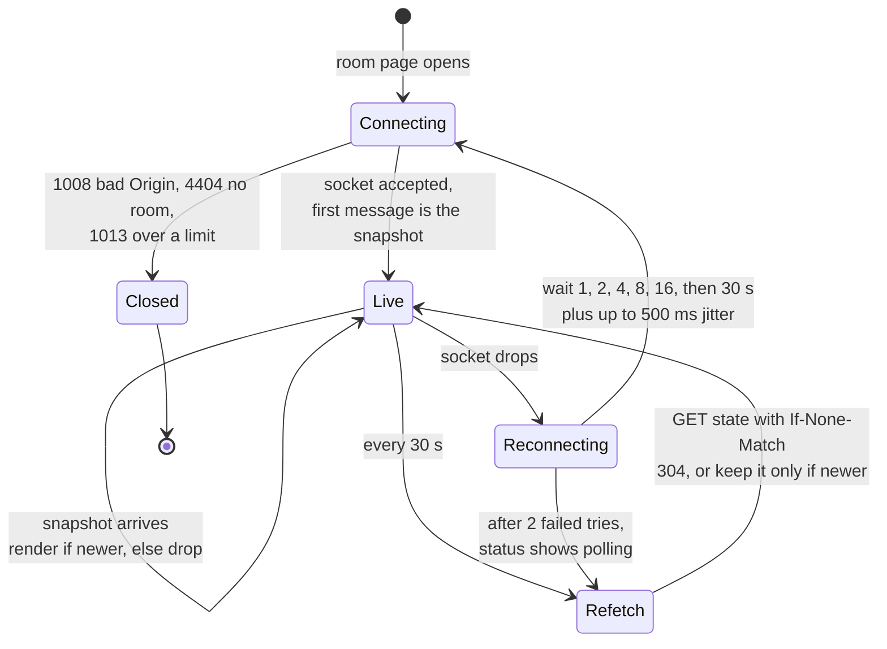

## 8. Record a payment

The protected path of `POST /api/rooms/{slug}/settlements`, in order. Every protected write (expenses, edits,
deletes, restores) follows the same first steps: lock the room row, re-check the key inside the lock, then the
version that write depends on.

<!-- diagram: seq-settle -->
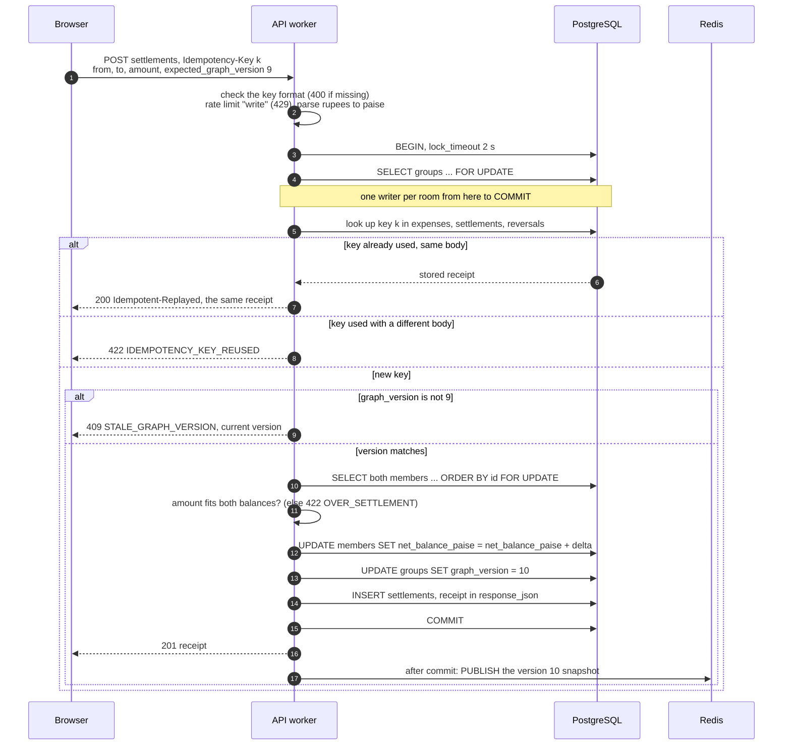

## 9. Ten devices, one payment

The chaos panel's two protected runs. Ten different keys race for one payment: the lock lines them up and the
version check rejects the nine that read version 9. Then one key sent ten times: the key check inside the lock
replays the first receipt.

<!-- diagram: seq-chaos -->
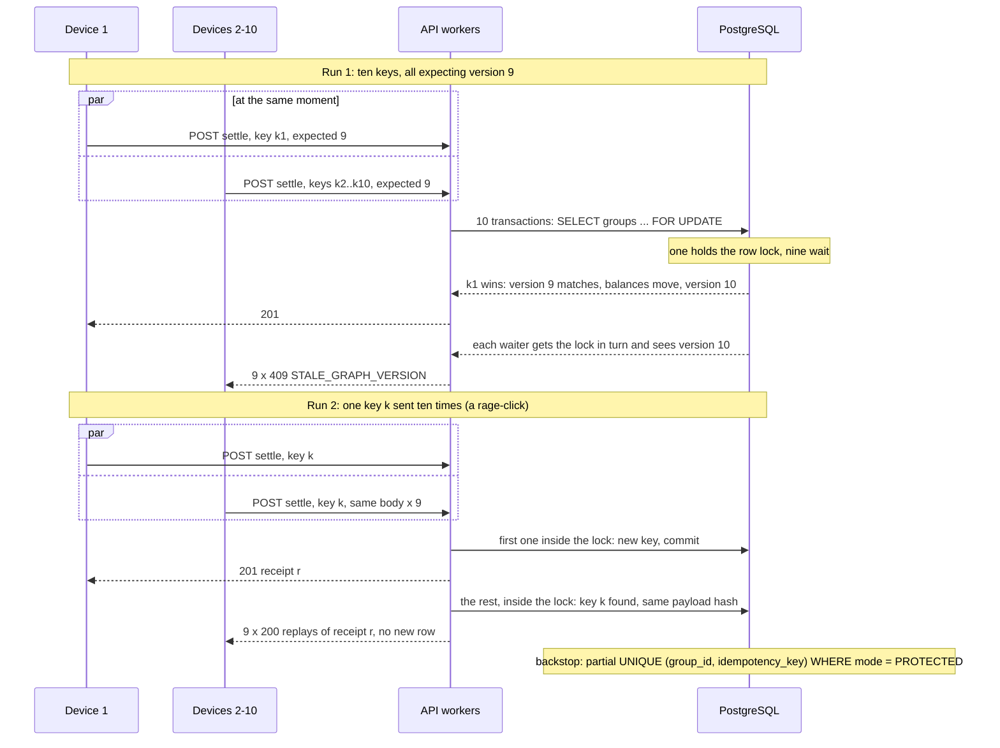

## 10. Two people edit one expense

You edit the version on your screen. The second editor's target was reversed by the first edit, so the write
stops inside the lock and names the version that replaced it. A change to any other expense never blocks you.

<!-- diagram: seq-edit -->
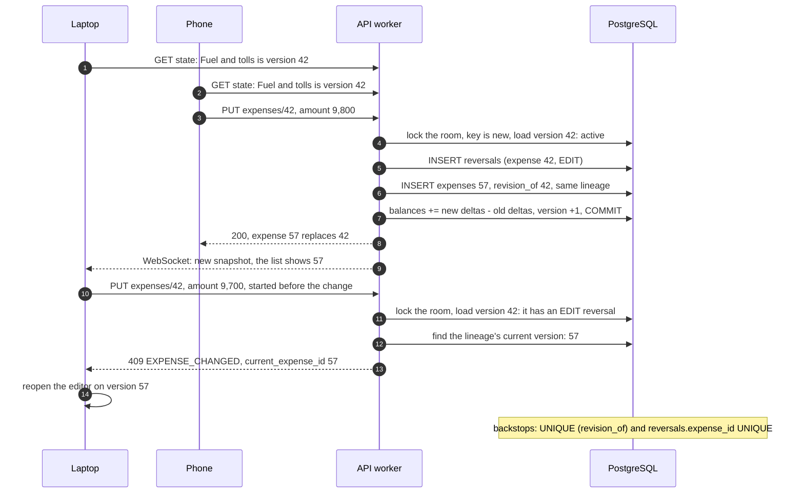

## 11. Naive mode loses an update

Demo rooms only. Naive mode reads balances without locks, waits 150 ms so requests overlap, and writes absolute
values: the classic lost update. Each write moves the payer and the payee by the same amount, so the sum stays
zero; only recomputing balances from the ledger shows the damage.

<!-- diagram: seq-naive -->
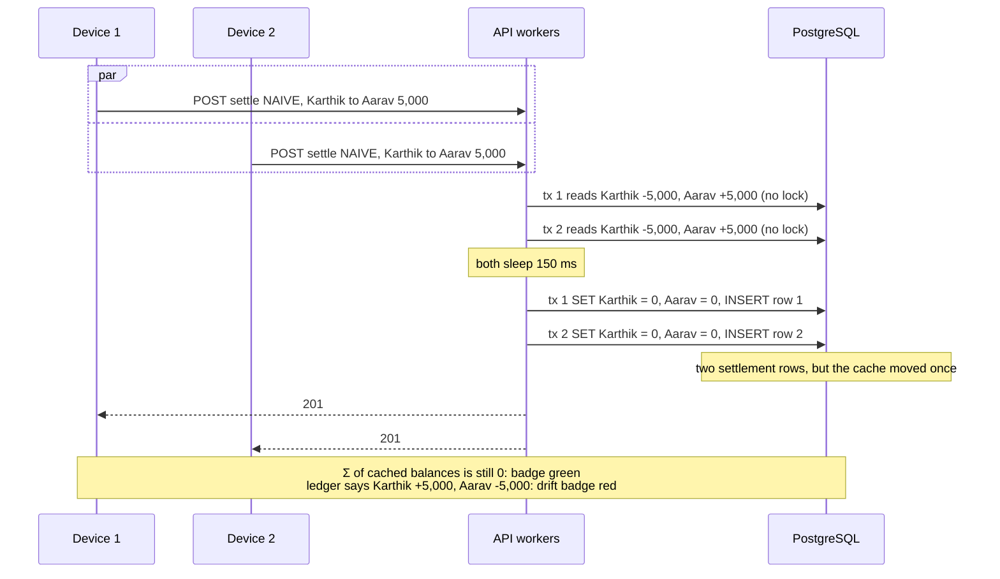

## 12. A write reaches every screen

The write commits on one worker, and its snapshot is published to Redis after the commit. Every worker is
subscribed, so each one sends the snapshot to its own sockets. Without Redis, the writing worker sends to its own
sockets and the rest heal on their next 30-second re-fetch.

<!-- diagram: seq-fanout -->
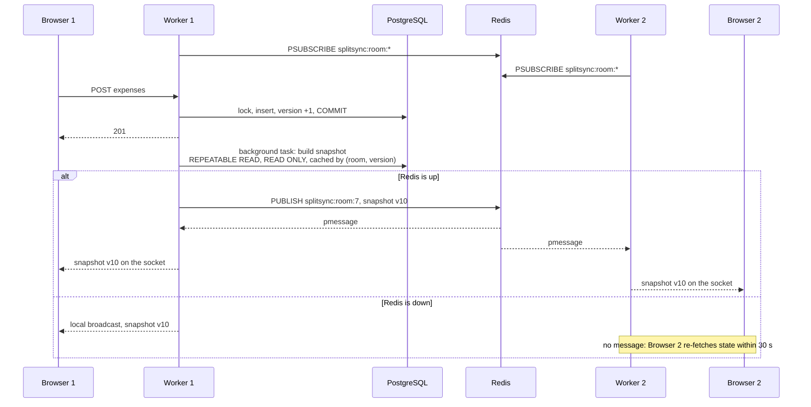

## 13. From balances to a plan

Each snapshot turns the room's balances into three answers. Pairwise IOUs come from active expenses only; the two
plans come from net balances. The exact solver is exponential, so above 15 people with a non-zero balance the room
shows the greedy plan, labelled as greedy.

<!-- diagram: plan-activity -->
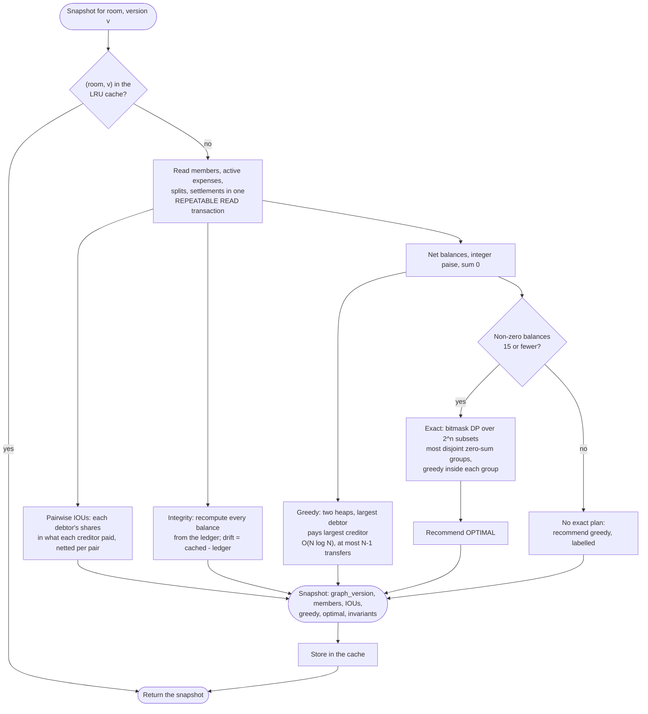

On the demo trip: 10 pairwise IOUs, greedy 4 transfers, exact 3 (groups {Karthik, Aarav} and
{Sneha, Priya, Rohan}).

## 14. Deploy and roll back

A push to `main` runs CI. When CI is green, `deploy.yml` sends the commit sha over SSH; the host's key line forces
`deploy.sh --from-ssh`, which accepts only a full sha, `--rollback` or `--status`.

<!-- diagram: seq-deploy -->
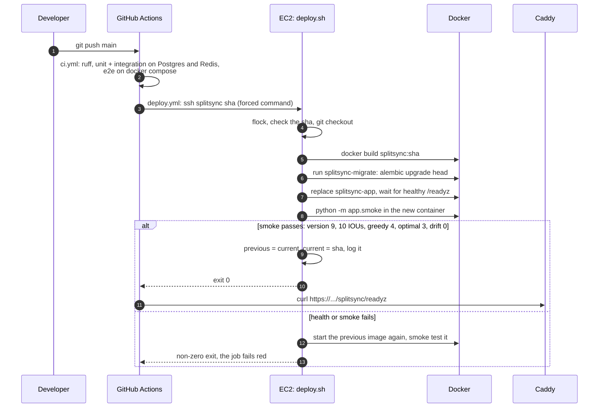
